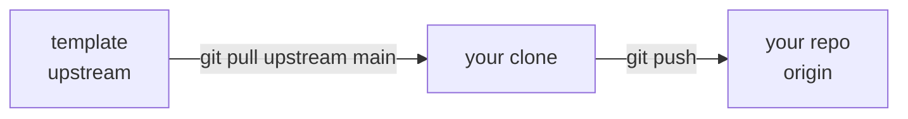

# 1-10 Get ready: your own repo

You set up the repo you will work in for the whole course. You create your own copy of the course template, install
the tools, run the checks, and learn how to pull new material from the template each week. At the end you push your
first commit.

## Background

The template is a small Node.js project that is already set up. It is split in two parts:

| The teacher updates (do not edit) | You write |
|---|---|
| `README.md`, `doc/`, `exercise/` | everything else: `src/`, `public/`, `practice/`, `report/`, the config files |

The files you get in your part at the start (the report templates, `package.json`, the config files) are given once
and never updated by the teacher, so they are yours to change.

Your repo has two remotes. `origin` is your own repo, where you push your work. `upstream` is the template, where you
pull new exercises and articles from. Since you never edit the teacher's files, a pull from `upstream` does not give
you conflicts.



## Before you start

You need the tools from [1-05 Lab environment](1-05-lab-environment.md): a bash terminal (Git Bash on Windows), Git,
Node.js 24 or later, and an SSH key on GitHub or GitLab.

## 1. Create your own repo

Your repo must exist on GitHub or GitLab before you can push to it.

1. Create a new, **empty** repo on GitHub or GitLab. Name it `intro-backend`. Do not add a README, `.gitignore` or
   licence; the template already has them.
2. Copy the SSH or HTTPS address of your new repo. You need it in the next step.

## 2. Clone the template and connect it to your repo

You are in the terminal, in the directory where you keep your course work. Clone the template, then make it `upstream`
and add your own repo as `origin`:

```bash
git clone <url-of-the-template> intro-backend
cd intro-backend
git remote rename origin upstream
git remote add origin <url-of-your-repo>
git push -u origin main
```

Check that both remotes are there:

```bash
git remote -v
```

Reload your repo in the browser: the template's files are now in it.

## 3. Install and run the checks

You are in the root of your repo. Install the packages the project uses:

```bash
npm install
```

This reads `package.json` and puts the packages in `node_modules/`. That directory is not committed (see
`.gitignore`); anyone who clones the repo runs `npm install` instead.

Open `package.json` and look at `scripts`. Run the check:

```bash
npm run check
```

It runs three things, all of which should pass:

| Script | Tool | What it does |
|---|---|---|
| `npm run lint` | ESLint (`eslint.config.js`) | Finds errors and suspicious code |
| `npm run format:check` | Prettier (`.prettierrc`) | Checks that the code follows one format: no semicolons, single quotes, 2 spaces |
| `npm test` | Node's built-in test runner | Runs every `*.test.js` file. There are none yet |

Two more scripts help you fix what the checks find:

```bash
npm run lint:fix   # let ESLint fix what it can
npm run format     # let Prettier format all files
```

Tests live next to the code they test: `todo.js` and `todo.test.js` in the same directory.

## 4. Look around

Open the repo in your editor and find these:

- `src/`: the app you build week by week.
- `public/`: static files (HTML, CSS, images) for the app.
- `practice/`: small exercises that stand on their own, one directory each.
- `report/`: one report per week. You fill in `week-01.md` at the end of this week.
- `exercise/` and `doc/`: the exercises and articles. New ones arrive each week.

## 5. Pull new material from the template

The teacher adds exercises during the course. Pull them like this, from the root of your repo:

```bash
git pull upstream main
git push
```

Do it now. You get "Already up to date" if nothing is new.

## Check and push

Start your report for the week: write a few lines in `report/week-01.md` about yourself and your setup (operating
system, editor, what was new). You continue the text at the end of the week. Then commit and push:

```bash
git add report/week-01.md
git commit -m "Get ready: my own repo"
git push
```

### Verify

- [ ] Your repo on GitHub or GitLab has the template's files and your commit.
- [ ] `git remote -v` shows `origin` (yours) and `upstream` (the template).
- [ ] `npm run check` passes.
- [ ] You can say which files you may edit, and why that keeps `git pull upstream main` free of conflicts.

<details>
<summary><code>git push</code> says "Permission denied (publickey)"</summary>

Your repo address is an SSH address, but your SSH key is not added to GitHub or GitLab. Either add your key (see the
help pages of GitHub or GitLab, "SSH keys"), or switch to the HTTPS address:

```bash
git remote set-url origin <https-url-of-your-repo>
```

</details>

<details>
<summary><code>git pull upstream main</code> gives a merge conflict</summary>

You have edited a file the teacher also changed, one in `README.md`, `doc/` or `exercise/`. Take the teacher's version
of that file and finish the merge:

```bash
git checkout --theirs <file>
git add <file>
git commit
```

</details>

## Read more

- The recorded lectures 1 and 2 in Canvas.
- npm scripts: https://docs.npmjs.com/cli/using-npm/scripts
- Git remotes: https://git-scm.com/book/en/v2/Git-Basics-Working-with-Remotes
