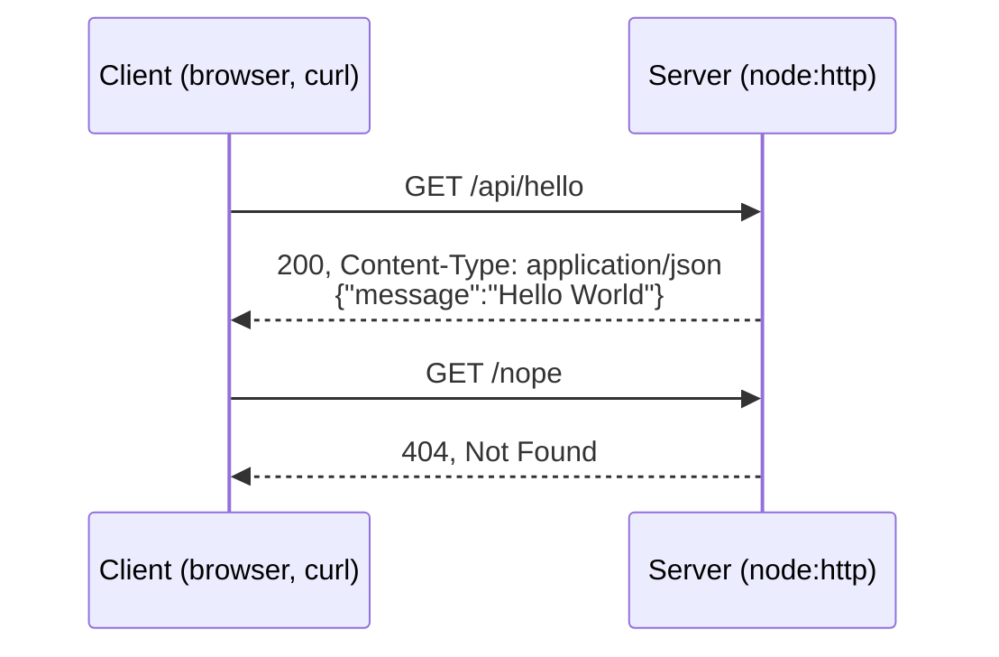

# 1-30 Hello World: a web server with node:http

You start the app that grows in `src/` through the course. This week it is the smallest web server there is, written
with only Node's built-in `node:http`: it answers `Hello World` as text on `/`, the same as JSON on `/api/hello`, and
404 on everything else. You meet the request and the response, status codes, the `Content-Type` header, and how to
test a server.

When you are done, `src/` has three files:

```
src/
├── app.js        creates the server and decides what to answer
├── app.test.js   tests that call the server over HTTP
└── server.js     starts the server on a port
```

## Background: request and response

A web server waits for requests. A client (the browser, `curl`, a test) sends a request with a **method** (`GET`) and
a **path** (`/api/hello`). The server sends back a response with a **status code** (`200` OK, `404` Not Found),
**headers** such as `Content-Type`, and a **body**.



In `node:http` you write one function that receives every request (`req`) and writes the response (`res`). What path
gives what answer is up to you. Next week Express takes over that part.

## 1. See where you are

`package.json` already has two scripts for the app: `npm start` runs `node src/server.js`, and `npm run dev` runs it
with `--watch`, so the server restarts when you save a file. Neither works yet, since `src/server.js` does not exist.

## 2. Create the app

`app.js` creates the server but does not start it. Keeping the two apart lets the tests start their own server.

Create `src/app.js`:

```js
import http from 'node:http'

export function createApp() {
  return http.createServer((req, res) => {
    if (req.method === 'GET' && req.url === '/') {
      res.writeHead(200, { 'Content-Type': 'text/plain; charset=utf-8' })
      res.end('Hello World\n')
      return
    }

    res.writeHead(404, { 'Content-Type': 'text/plain; charset=utf-8' })
    res.end('Not Found\n')
  })
}
```

`res.writeHead()` sets the status code and the headers, `res.end()` sends the body and ends the response. The `return`
makes sure only one response is sent.

## 3. Start the server

`server.js` starts the app on a port. Create `src/server.js`:

```js
import { createApp } from './app.js'

const port = process.env.PORT ?? 3000

createApp().listen(port, () => {
  console.log(`Server listening on http://localhost:${port}`)
})
```

`process.env.PORT ?? 3000` uses the port from the environment variable `PORT` if it is set, otherwise 3000.

Start it in dev mode:

```bash
npm run dev
```

Open http://localhost:3000/ in the browser, then try it from a second terminal:

```bash
curl -i http://localhost:3000/
curl -i http://localhost:3000/nope
```

`-i` shows the status line and the headers as well as the body. Find `200`, `404` and `Content-Type` in the output.

## 4. Answer with JSON

An API answers with JSON instead of text. Add a route for `GET /api/hello` in `src/app.js`, after the route for `/`,
that answers status 200 with this body:

```json
{ "message": "Hello World" }
```

Two things differ from the text route: the `Content-Type` is `application/json`, and the body is an object turned
into a string with `JSON.stringify()`.

<details>
<summary>The route</summary>

```js
if (req.method === 'GET' && req.url === '/api/hello') {
  res.writeHead(200, { 'Content-Type': 'application/json' })
  res.end(JSON.stringify({ message: 'Hello World' }))
  return
}
```

</details>

Save, and the server restarts. Try it:

```bash
curl -i http://localhost:3000/api/hello
```

## 5. Test the server

The tests start the app on port 0, which means "any free port", and call it with `fetch()`, which is built into Node.
Create `src/app.test.js`:

```js
import { test, before, after } from 'node:test'
import assert from 'node:assert/strict'
import { createApp } from './app.js'

let server
let baseUrl

// Start the server on a free port before the tests, stop it after.
before(async () => {
  server = createApp()
  await new Promise((resolve) => server.listen(0, resolve))
  baseUrl = `http://localhost:${server.address().port}`
})

after(() => server.close())

test('GET / says Hello World', async () => {
  const res = await fetch(`${baseUrl}/`)
  assert.equal(res.status, 200)
  assert.equal(await res.text(), 'Hello World\n')
})

test('an unknown path gives 404', async () => {
  const res = await fetch(`${baseUrl}/nope`)
  assert.equal(res.status, 404)
})
```

Run the tests with `npm test`. Then add a test of your own for `GET /api/hello`: check the status, that the
`content-type` header contains `application/json`, and the body.

<details>
<summary>The test</summary>

```js
test('GET /api/hello answers with JSON', async () => {
  const res = await fetch(`${baseUrl}/api/hello`)
  assert.equal(res.status, 200)
  assert.match(res.headers.get('content-type'), /application\/json/)
  assert.deepEqual(await res.json(), { message: 'Hello World' })
})
```

</details>

## Check and push

Stop the server with `Ctrl+C`, then:

```bash
npm run check
git add src
git commit -m "1-30 Hello World with node:http"
git push
```

### Verify

- [ ] `npm start` starts the server, and `/`, `/api/hello` and `/nope` answer as they should in the browser and with
      `curl -i`.
- [ ] `npm run check` passes, with your test for `/api/hello` included.
- [ ] You can explain method, path, status code, `Content-Type` and body, using the output of `curl -i`.
- [ ] You can say why `app.js` and `server.js` are two files.

<details>
<summary><code>Error: listen EADDRINUSE: address already in use :::3000</code></summary>

A server is already running on port 3000, maybe in another terminal. Stop it with `Ctrl+C`, or start on another port:
`PORT=3001 npm start`.

</details>

<details>
<summary>The browser shows the old answer after you changed the code</summary>

`npm start` does not restart on changes. Use `npm run dev`, or stop and start the server again.

</details>

## Challenge

Add a route `GET /` that sends the file `public/index.html` instead of text. Read the file with `readFile` from
`node:fs/promises` and use the `Content-Type` `text/html; charset=utf-8`. What happens with a CSS file the page links
to? That is the problem Express solves next week.

## Write your report

This was the last exercise of the week. Write your report in `report/week-01.md`: [report/README.md](../report/README.md)
tells you how, and the week page in Canvas has the points for the week. Commit and push it.

## Read more

- The recorded lectures in Canvas for this week.
- HTTP in Node.js: https://nodejs.org/api/http.html
- An overview of HTTP: https://developer.mozilla.org/en-US/docs/Web/HTTP/Guides/Overview
