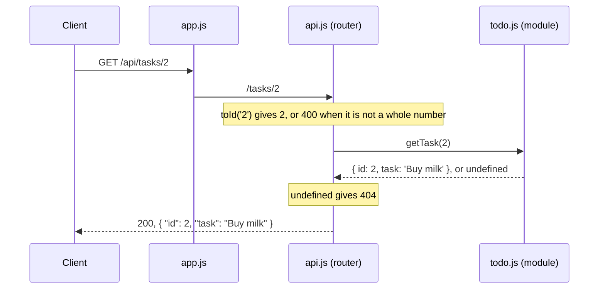

# 2-50 The to-do API: your own JSON API

In 1-20 you wrote the to-do list as a module, `todo.js`, and a main program that printed the list. In this exercise
the same module gets an API instead: a server that answers with the tasks as JSON. You write the code yourself, and
you start from your own code from 1-20. The exercise says what each route must answer and gives you hints, and the
tests tell you when you are done. There is no solution to copy; it is shown in the Friday session of week 3.

This is what happens, step by step:

- You copy your module from 1-20 into a project of its own, `todo/`, and add a server that answers 404 as JSON.
- You add two functions to the module that give the tasks as objects with an `id`.
- You write the routes, in a router as in 2-20, and try each with `curl`.
- You add the tests, which are given, and run them until they all pass.

The to-do list grows through the course: in the coming weeks it moves to a database and gets more routes.

You need 1-20 and 2-20 done. When you are done, your repo has a new directory next to `src/`:

```
todo/
├── app.js            starts the server
└── src/
    ├── todo.js       your module from 1-20, with two new functions
    ├── todo.test.js  your tests from 1-20
    ├── api.js        the API routes, in a router
    └── api.test.js   the tests of the API
```

The to-do API is a project of its own, so it does not go in `src/`, which holds the app of the other exercises.

## Background: a JSON API

The app in `src/` answers with web pages and some JSON. A JSON API answers only with JSON, also when something is
wrong, so that a program can read every answer, not only a person. Each task gets an `id`, its number in the list, so
a client can ask for one task by its id:

| Route | Answer |
|---|---|
| `GET /api/tasks` | all tasks, as an array |
| `GET /api/tasks/:id` | one task |

This is the same as in 2-20: a route parameter, `res.json()`, and 400 or 404 with an error as JSON when the request
is wrong.

The route and the module share the work. The route reads the URL and picks the status code, the module finds the
task:



## 1. The project and the server

Create the directory and copy your module and its tests from 1-20, from the root of your repo:

```bash
mkdir -p todo/src
cp practice/1-20/todo.js practice/1-20/todo.test.js todo/src/
```

Your files in `practice/1-20/` stay as they are. Run the tests you copied, to see that the module works in its new
place:

```bash
npm test -- todo
```

Create `todo/app.js`, which starts the server. It is given; you know its parts from 2-10 and 2-20:

```js
import express from 'express'
import api from './src/api.js'
import { addTask } from './src/todo.js'

const app = express()
const port = process.env.PORT ?? 3000

// The list lives in memory and is empty when the server starts, so add a few tasks
addTask('Wash clothes')
addTask('Buy milk')
addTask('Call grandma')

app.use('/api', api)

// Every other path: 404 with an error as JSON
app.use((req, res) => {
  res.status(404).json({ error: 'Not found' })
})

app.listen(port, (error) => {
  if (error) {
    throw error
  }
  console.log(`To-do API listening on http://localhost:${port}`)
})
```

The last `app.use()` has no path, so it gets every request that no route above it answered. An API answers with JSON
also when the path is wrong, instead of the HTML page Express sends by default.

Add a script to `package.json`, after `"check"`. The `"check"` line gets a comma at its end, since a line follows it
now; the last line has none:

```json
    "check": "npm run lint && npm run format:check && npm test",
    "todo": "node --watch todo/app.js"
```

`npm run todo` cannot start yet, since `src/api.js` is missing. That is next.

## 2. Two new functions in `todo.js`

Your module stores each task as a string, and `getTasks()` gives them as an array of strings. The API answers with
objects that have an `id`, the number of the task in the list (1, 2, 3 …):

```json
{ "id": 2, "task": "Buy milk" }
```

The routes should not build those objects or search the list themselves. That is the job of the module. Add two
functions last in `todo/src/todo.js`:

```js
export function getTaskList() {
  // 1. Return all tasks as an array of objects { id, task }, where id is the number of the task (1, 2, 3 …)
}

export function getTask(id) {
  // 2. Return the task with that id as { id, task }, or undefined when there is none
}
```

The functions return values and never print, and an id is a number here: `getTask(2)`, not `getTask('2')`. Turning
the string from the URL into a number is the job of the route.

Hints:

- `getTasksAsJson()` from 1-20 already builds such a list, with the key `number` instead of `id`. `getTaskList()`
  does the same, but returns the array itself, not a string: `res.json()` turns it into JSON later.
- `getTask()` can use `getTaskList()` and look for the object with that `id`. Look at `find()` in
  [Array on MDN](https://developer.mozilla.org/en-US/docs/Web/JavaScript/Reference/Global_Objects/Array/find).

Try the module from the root of your repo before you go on, with a line of Node:

```bash
node -e "import('./todo/src/todo.js').then((t) => { t.addTask('Milk'); console.log(t.getTaskList(), t.getTask(1)) })"
```

## 3. The routes: `api.js`

Create `todo/src/api.js` with a router, as in 2-20, and export it with `export default router`. Write one route at
a time, start the server and try it with `curl`:

```bash
export PORT=3000
npm run todo
```

```bash
curl -i http://localhost:$PORT/api/tasks
```

The routes must answer like this, with the three tasks from `app.js`. The tests in step 4 check every line of the
table.

| Request | Status | Body |
|---|---|---|
| `GET /api/tasks` | 200 | `[{ "id": 1, "task": "Wash clothes" }, { "id": 2, "task": "Buy milk" }, …]` |
| `GET /api/tasks/2` | 200 | `{ "id": 2, "task": "Buy milk" }` |
| `GET /api/tasks/42` | 404 | `{ "error": "Task 42 not found" }` |
| `GET /api/tasks/abc` | 400 | `{ "error": "The id must be a whole number" }` |

The wording of the error messages is yours; the tests check that there is an `error` with a text.

Hints:

- The id comes as a string in `req.params.id`. Turn it into a number before you call `getTask()`. A small helper does
  it, and answers `undefined` when the string is not a whole number, so `abc`, `1.5` and `-1` are all wrong:

  ```js
  /** A whole number from the URL, or undefined when it is not one. */
  function toId(value) {
    return /^\d+$/.test(value) ? Number(value) : undefined
  }
  ```

  `/^\d+$/` is a regular expression that means "only digits, from start to end".

- 400 and 404 are answered as in 2-20: `return res.status(...).json({ error: ... })`, with `return` so the route
  stops there.
- Check the input first (400), then look for the task (404), then answer (200).

## 4. The tests

The tests are given. Create `todo/src/api.test.js`:

```js
import { test, before, after } from 'node:test'
import assert from 'node:assert/strict'
import express from 'express'
import api from './api.js'
import { addTask, clearTasks } from './todo.js'

let server
let baseUrl

// Three tasks in the list, and a small app with only the API router, on a free port (0).
before(async () => {
  clearTasks()
  addTask('Wash clothes')
  addTask('Buy milk')
  addTask('Call grandma')

  const app = express()
  app.use('/api', api)
  await new Promise((resolve) => {
    server = app.listen(0, resolve)
  })
  baseUrl = `http://localhost:${server.address().port}/api`
})

after(() => server.close())

async function get(path) {
  const res = await fetch(`${baseUrl}${path}`)
  return { status: res.status, type: res.headers.get('content-type'), body: await res.json() }
}

test('GET /tasks gives all tasks, with id and task', async () => {
  const { status, type, body } = await get('/tasks')
  assert.equal(status, 200)
  assert.match(type, /application\/json/)
  assert.deepEqual(body, [
    { id: 1, task: 'Wash clothes' },
    { id: 2, task: 'Buy milk' },
    { id: 3, task: 'Call grandma' },
  ])
})

test('GET /tasks/2 gives task 2', async () => {
  const { status, type, body } = await get('/tasks/2')
  assert.equal(status, 200)
  assert.match(type, /application\/json/)
  assert.deepEqual(body, { id: 2, task: 'Buy milk' })
})

test('a task that does not exist gives 404 with an error', async () => {
  for (const path of ['/tasks/0', '/tasks/4', '/tasks/9999']) {
    const { status, body } = await get(path)
    assert.equal(status, 404, path)
    assert.equal(typeof body.error, 'string', path)
  }
})

test('an id that is not a whole number gives 400 with an error', async () => {
  for (const path of ['/tasks/abc', '/tasks/1.5', '/tasks/-1']) {
    const { status, body } = await get(path)
    assert.equal(status, 400, path)
    assert.equal(typeof body.error, 'string', path)
  }
})
```

Run them:

```bash
npm test -- todo
```

The tests put their own three tasks in the list and start a small app with only your router, on a free port, so you
do not need the server running. Fix your code until all of them pass. Read the name of a failing test and the lines
under it: they say what was expected and what your API answered.

## Check and commit

Stop the server with `Ctrl+C`, then:

```bash
npm run check
git add todo package.json
git commit -m "2-50 The to-do API"
```

If you have a remote of your own, push with `git push`.

### Verify

- [ ] `npm run todo` starts the server, and every row in the table in step 3 answers as it should with `curl`.
- [ ] `npm test -- todo` passes all the tests, and `npm run check` passes for the whole repo.
- [ ] The routes in `api.js` get their tasks only through the functions in `todo.js`.
- [ ] You can say why the route turns the id into a number, and why `todo.js` takes a number and not a string.
- [ ] You can say when the answer is 200, 400 or 404.

<details>
<summary><code>Error [ERR_MODULE_NOT_FOUND]: Cannot find module '.../todo/src/api.js'</code></summary>

`app.js` imports `./src/api.js`, so `npm run todo` cannot start before that file exists. Create it, with at least
a router and `export default router`.

</details>

<details>
<summary><code>does not provide an export named 'getTaskList'</code> (or <code>clearTasks</code>)</summary>

The function is missing in `todo/src/todo.js`, or it has no `export` in front of it. `clearTasks()` is from 1-20; if
you did not write it then, add it now: it empties the list.

</details>

<details>
<summary>A test says <code>Expected values to be strictly equal: 404 !== 200</code> for <code>/tasks/2</code></summary>

The id from the URL is the string `'2'`, and `task.id === '2'` is false for the number `2`. Turn the id into a number
in the route, with `toId()`, before you call `getTask()`.

</details>

<details>
<summary><code>npm test</code> or <code>curl</code> hangs and never ends</summary>

A route never answers: there is a way through it that reaches no `res.json()`, for example an `if` without the
answer in one of its branches. Run the request with `curl` to find which route it is, stop with `Ctrl+C`, and follow
the code of that route step by step.

</details>

## Challenge

Add `?search=` to `GET /api/tasks`, for the tasks whose text contains the search word: `/api/tasks?search=milk`. No
match is an empty array, not an error. Write the test first, then the code.

## Read more

- `Array.prototype.find()`:
  https://developer.mozilla.org/en-US/docs/Web/JavaScript/Reference/Global_Objects/Array/find
- Routing in Express: https://expressjs.com/en/guide/routing.html
- HTTP status codes 400 and 404:
  https://developer.mozilla.org/en-US/docs/Web/HTTP/Reference/Status/400 and
  https://developer.mozilla.org/en-US/docs/Web/HTTP/Reference/Status/404
- [Testing with Node.js](../doc/testing-with-node.md), the section "Testing a web server".
